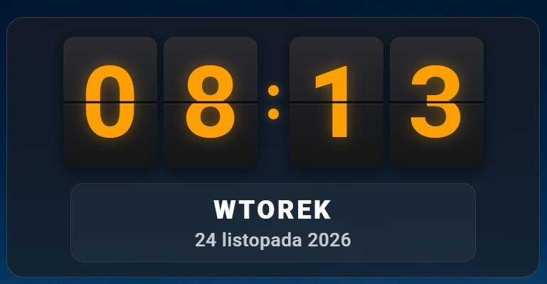
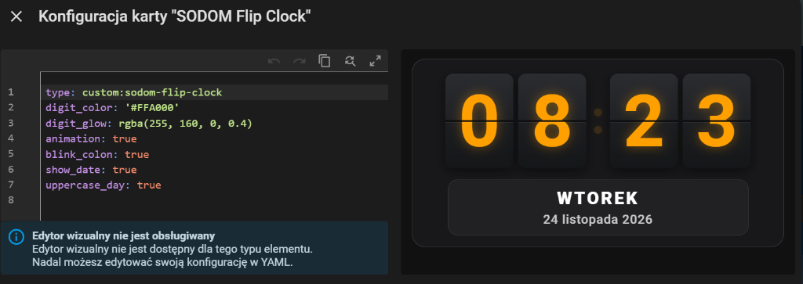

# SODOM Flip Clock (`custom:sodom-flip-clock`)

A lightweight retro split-flap clock Lovelace card for Home Assistant with smooth flip animation, GPU-accelerated blinking colon, server timezone synchronization, and multi-language support (English and Polish).

Built specifically to solve common issues on wall-mounted dashboard tablets (including older Android 7.0 / 8.0 devices with legacy WebViews).



---

## Key Highlights

- **Multi-language Auto-detection:** Automatically displays the day of week and date in Polish if Home Assistant is set to Polish, or in English for any other language. Can also be manually forced in YAML (`language: en` or `language: pl`).
- **Full Compatibility with Legacy Tablets:** Does not use CSS Container Queries (`cqw` / `@container`) that collapse cards to 0 px on WebView < 105 (e.g. Android 7.0 / Nougat). Responsiveness is handled smoothly via `ResizeObserver`.
- **True Timezone Sync:** Reads `hass.config.time_zone` directly from your Home Assistant server, preventing wrong time displays on tablets with desynchronized local clocks or missing battery RTCs.
- **0% CPU Overhead:** The blinking colon runs entirely on GPU keyframes (`opacity: 1 <-> 0.15`). The 3D flip animation triggers only for the specific digit that changes.

---

## Configuration



Add a **Manual Card** to your dashboard and configure it using YAML:

```yaml
type: custom:sodom-flip-clock
language: auto
digit_color: '#FFA000'
digit_glow: 'rgba(255, 160, 0, 0.35)'
animation: true
blink_colon: true
show_date: true
uppercase_day: true
```

### Options Explained

| Parameter | Type | Default | Description |
|---|---|---|---|
| `type` | string | **required** | `custom:sodom-flip-clock` |
| `language` | string | `auto` | Language for date and day name. Options: `auto`, `en`, `pl`. In `auto` mode, detects HA Polish locale or falls back to English. |
| `digit_color` | string (HEX/RGB) | `#FFA000` | Primary color of the digits and colon dots. Vintage amber, neon green, bright white, etc. |
| `digit_glow` | string (CSS) | `rgba(255, 160, 0, 0.35)` | Subtle neon glow around numbers and dots. Set to `none` or `transparent` for matte plastic flaps. |
| `animation` | boolean | `true` | Enables 3D split-flap rotation when digits update. |
| `blink_colon` | boolean | `true` | 1 Hz blinking colon between hours and minutes. |
| `show_date` | boolean | `true` | Shows weekday name and formatted full date below the clock. |
| `uppercase_day` | boolean | `true` | Capitalizes the weekday name (e.g. `TUESDAY` / `WTOREK`). |
| `time_zone` | string | `''` (auto) | Custom IANA timezone (e.g. `Europe/Warsaw`, `America/New_York`). Defaults to Home Assistant server timezone. |

---

## Styling Presets

### 1. Vintage Amber Classic (Default)
Warm amber glow matching classic terminal screens and station boards:
```yaml
type: custom:sodom-flip-clock
digit_color: '#FFA000'
digit_glow: 'rgba(255, 160, 0, 0.35)'
```

### 2. Modern Clean White
Neutral, crisp white numbers on dark smoked glass:
```yaml
type: custom:sodom-flip-clock
digit_color: '#FFFFFF'
digit_glow: 'rgba(255, 255, 255, 0.2)'
```

### 3. Cyber Matrix Green
High-contrast neon green look:
```yaml
type: custom:sodom-flip-clock
digit_color: '#00FF66'
digit_glow: 'rgba(0, 255, 102, 0.45)'
```

### 4. Minimalist Matte (No Glow, Time Only)
Clean matte digits without glow and without date box:
```yaml
type: custom:sodom-flip-clock
digit_color: '#E0E0E0'
digit_glow: 'none'
show_date: false
```

---

## Installation

### Manual Installation
1. Copy `sodom-flip-clock.js` to `/config/www/` on your Home Assistant instance.
2. In Home Assistant, navigate to **Settings -> Dashboards -> (three dots) -> Resources -> Add Resource**:
   - **URL:** `/local/sodom-flip-clock.js?v=1.1.0`
   - **Resource Type:** `JavaScript Module`
3. Add a **Manual Card** to your dashboard and paste your YAML configuration.
4. Hard-refresh browser cache (`Ctrl + F5` or restart Fully Kiosk).

### HACS Installation (Custom Repository)
1. In HACS, click the three dots in the top right corner and select **Custom repositories**.
2. Add `hookmt/sodom-flip-clock` with category **Dashboard** (or **Lovelace**).
3. Click **Download** and reload resources.

---

## Polska dokumentacja (skrót)

### Opcje językowe:
- `language: auto` - jeśli interfejs Home Assistanta jest w języku polskim, karta automatycznie wyświetla polskie dni tygodnia (`WTOREK`) i format daty (`24 listopada 2026`). W przypadku innych języków automatycznie przełącza się na angielski.
- `language: pl` - wymuszenie języka polskiego bez względu na ustawienia profilu HA.
- `language: en` - wymuszenie języka angielskiego (`TUESDAY`, `November 24, 2026`).

### Kolory i poświata:
- `digit_color` odpowiada za kolor cyfr oraz kropek dwukropka.
- `digit_glow` tworzy neonową poświatę wokół cyfr. Wpisanie `none` wyłącza efekt, dając klasyczny, matowy wygląd tworzywa sztucznego.
